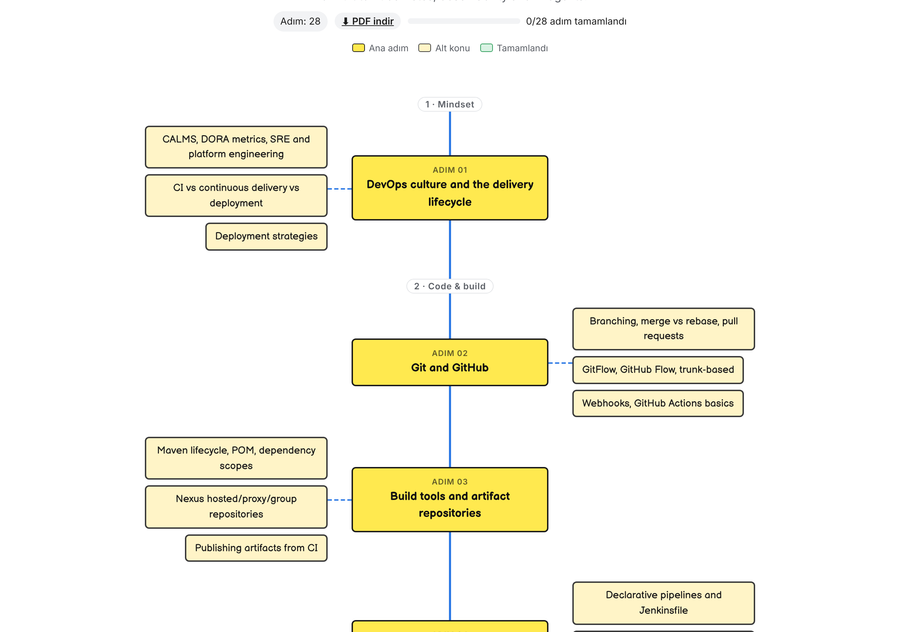
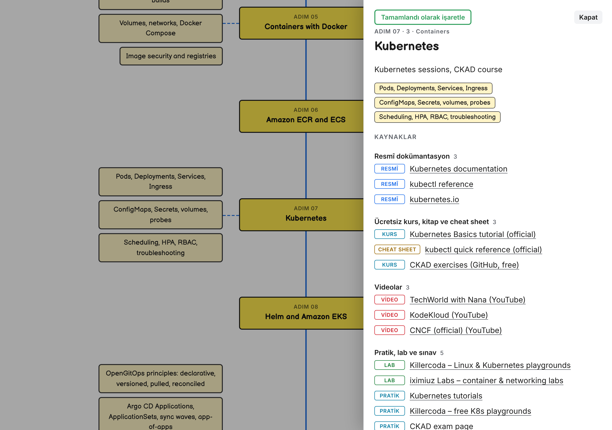

<div align="center">

# ☁️ Cloud Career Roadmaps

**AWS, AWS sertifikaları, DevOps, Kubernetes, Kubernetes sertifikası, Azure, Azure DevOps, DevSecOps, FinOps ve Cloud Security için roadmap.sh tarzı, interaktif ve ücretsiz öğrenme yol haritaları.**
Her adım resmî dokümantasyona ve doğrulanmış, ücretsiz/açık kaynaklara bağlanır.

[](https://alexduncan2100.github.io/cloud-career-roadmaps/)
[](https://github.com/AlexDuncan2100/cloud-career-roadmaps/stargazers)
[](LICENSE)

**[🚀 Siteyi aç](https://alexduncan2100.github.io/cloud-career-roadmaps/)** · [English](#-english)

<a href="https://alexduncan2100.github.io/cloud-career-roadmaps/"></a>

</div>

## Ne var?

| | |
|---|---|
| 🗺️ **10 yol haritası** | AWS, AWS Certificates, DevOps, Kubernetes, Kubernetes Certification, Azure, Azure DevOps, DevSecOps, FinOps, Cloud Security |
| 📚 **175 adım** | Her adımda alt konular ve o adıma ait kaynaklar |
| 🔗 **~1358 kaynak linki** | Resmî dokümanlar, resmî siteler ve GitHub repoları, YouTube kanalları, ücretsiz kurslar, ücretsiz online kitaplar, cheat sheet'ler, lab'lar |
| ✅ **İlerleme takibi** | Adımları "tamamlandı" olarak işaretle; ilerleme tarayıcında saklanır |
| 📄 **PDF sürümleri** | Her yol haritasının tıklanabilir PDF'i [`pdf/`](pdf/) klasöründe |
| 📱 **Her cihazda** | Telefon, tablet, masaüstü; açık ve koyu tema |

## Nasıl kullanılır?

1. **[Siteyi aç](https://alexduncan2100.github.io/cloud-career-roadmaps/)** ve üstteki sekmelerden bir yol haritası seç.
2. Sarı **adım** kutusuna ya da yanındaki **alt konu** kutusuna tıkla. Sağda o adımın kaynakları türlerine göre açılır.
3. Linke tıkla, kaynağı oku ya da izle. Bitirince **"Tamamlandı olarak işaretle"** butonuna bas.

Doğrudan linkler: [AWS](https://alexduncan2100.github.io/cloud-career-roadmaps/#aws) · [AWS Certificates](https://alexduncan2100.github.io/cloud-career-roadmaps/#awscert) · [DevOps](https://alexduncan2100.github.io/cloud-career-roadmaps/#devops) · [Kubernetes](https://alexduncan2100.github.io/cloud-career-roadmaps/#kube) · [Kubernetes Certification](https://alexduncan2100.github.io/cloud-career-roadmaps/#k8s) · [Azure](https://alexduncan2100.github.io/cloud-career-roadmaps/#azure) · [Azure DevOps](https://alexduncan2100.github.io/cloud-career-roadmaps/#azdevops) · [DevSecOps](https://alexduncan2100.github.io/cloud-career-roadmaps/#devsecops) · [FinOps](https://alexduncan2100.github.io/cloud-career-roadmaps/#finops) · [Cloud Security](https://alexduncan2100.github.io/cloud-career-roadmaps/#cloudsec)

<table>
<tr>
<td width="62%"><br><sub>Bir kutuya tıklayınca kaynaklar türlerine göre açılır.</sub></td>
<td width="38%"><br><sub>Telefonda da aynı şekilde çalışır.</sub></td>
</tr>
</table>

## Yol haritaları

| Yol haritası | Adım | PDF |
|---|---|---|
| [AWS](https://alexduncan2100.github.io/cloud-career-roadmaps/#aws) | 27 | [PDF](pdf/AWS%20Roadmap.pdf) |
| [AWS Certificates](https://alexduncan2100.github.io/cloud-career-roadmaps/#awscert) | 14 | [PDF](pdf/AWS%20Certificate%20Roadmap.pdf) |
| [DevOps](https://alexduncan2100.github.io/cloud-career-roadmaps/#devops) | 28 | [PDF](pdf/DevOps%20Roadmap.pdf) |
| [Kubernetes](https://alexduncan2100.github.io/cloud-career-roadmaps/#kube) | 12 | [PDF](pdf/Kubernetes%20Roadmap.pdf) |
| [Kubernetes Certification](https://alexduncan2100.github.io/cloud-career-roadmaps/#k8s) | 9 | [PDF](pdf/Kubernetes%20Certification%20Roadmap.pdf) |
| [Azure](https://alexduncan2100.github.io/cloud-career-roadmaps/#azure) | 23 | [PDF](pdf/Azure%20Roadmap.pdf) |
| [Azure DevOps](https://alexduncan2100.github.io/cloud-career-roadmaps/#azdevops) | 17 | [PDF](pdf/Azure%20DevOps%20Roadmap.pdf) |
| [DevSecOps](https://alexduncan2100.github.io/cloud-career-roadmaps/#devsecops) | 16 | [PDF](pdf/DevSecOps%20Roadmap.pdf) |
| [FinOps](https://alexduncan2100.github.io/cloud-career-roadmaps/#finops) | 15 | [PDF](pdf/FinOps%20Roadmap.pdf) |
| [Cloud Security](https://alexduncan2100.github.io/cloud-career-roadmaps/#cloudsec) | 14 | [PDF](pdf/Cloud%20Security%20Roadmap.pdf) |

## Kaynak kuralları

- Yalnızca resmî ve ücretsiz/açık kaynaklar yer alır; sınav dump siteleri yoktur.
- Linkler 27 Kasım 2026'da tek tek açılarak doğrulandı; doğrulanamayan linkler eklenmedi.

---

## 🇬🇧 English

Interactive, free, roadmap.sh-style learning roadmaps for **AWS, AWS certifications, DevOps, Kubernetes, Kubernetes certification, Azure, Azure DevOps, DevSecOps, FinOps and Cloud Security**. Click a step or subtopic to open its resources (official docs, official sites and GitHub repos, YouTube channels, free courses, free online books, cheat sheets, labs), mark steps as done, and download the PDF version of each roadmap.

**[Open the site](https://alexduncan2100.github.io/cloud-career-roadmaps/)** · Links verified on 27 November 2026 · Only official and free/open resources.

## Build

```bash
python3 src/build.py   # builds index.html from src/template.html and src/data.json
```

## License

[MIT](LICENSE)
