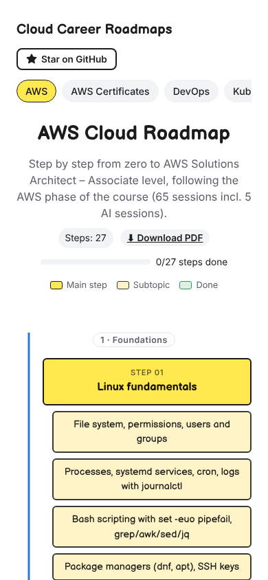

<div align="center">

# ☁️ Cloud Career Roadmaps

**Interactive, free, roadmap.sh-style learning roadmaps for AWS, AWS certifications, DevOps, Kubernetes, Kubernetes certification, Azure, Azure DevOps, DevSecOps, FinOps and Cloud Security.**
Every step links to official documentation and verified free/open resources.

[](https://alexduncan2100.github.io/cloud-career-roadmaps/)
[](https://github.com/AlexDuncan2100/cloud-career-roadmaps/stargazers)
[](LICENSE)

**[🚀 Open the site](https://alexduncan2100.github.io/cloud-career-roadmaps/)**

<a href="https://alexduncan2100.github.io/cloud-career-roadmaps/"></a>

</div>

## What's inside

| | |
|---|---|
| 🗺️ **10 roadmaps** | AWS, AWS Certificates, DevOps, Kubernetes, Kubernetes Certification, Azure, Azure DevOps, DevSecOps, FinOps, Cloud Security |
| 📚 **175 steps** | Each step has subtopics and its own resources |
| 🔗 **~1358 resource links** | Official docs, official sites and GitHub repos, YouTube channels, free courses, free online books, cheat sheets, labs |
| ✅ **Progress tracking** | Mark steps as done; progress is saved in your browser |
| 📄 **PDF versions** | A clickable PDF of every roadmap in the [`pdf/`](pdf/) folder |
| 📱 **Any device** | Phone, tablet, desktop; light and dark theme |

## How to use

1. **[Open the site](https://alexduncan2100.github.io/cloud-career-roadmaps/)** and pick a roadmap from the tabs at the top.
2. Click a yellow **step** box or a **subtopic** box next to it. The step's resources open on the right, grouped by type.
3. Open a link, read or watch it, then press **"Mark as done"**.

Direct links: [AWS](https://alexduncan2100.github.io/cloud-career-roadmaps/#aws) · [AWS Certificates](https://alexduncan2100.github.io/cloud-career-roadmaps/#awscert) · [DevOps](https://alexduncan2100.github.io/cloud-career-roadmaps/#devops) · [Kubernetes](https://alexduncan2100.github.io/cloud-career-roadmaps/#kube) · [Kubernetes Certification](https://alexduncan2100.github.io/cloud-career-roadmaps/#k8s) · [Azure](https://alexduncan2100.github.io/cloud-career-roadmaps/#azure) · [Azure DevOps](https://alexduncan2100.github.io/cloud-career-roadmaps/#azdevops) · [DevSecOps](https://alexduncan2100.github.io/cloud-career-roadmaps/#devsecops) · [FinOps](https://alexduncan2100.github.io/cloud-career-roadmaps/#finops) · [Cloud Security](https://alexduncan2100.github.io/cloud-career-roadmaps/#cloudsec)

<table>
<tr>
<td width="62%"><br><sub>Click a box to open its resources, grouped by type.</sub></td>
<td width="38%"><br><sub>Works the same on a phone.</sub></td>
</tr>
</table>

## Roadmaps


| Roadmap | Steps | PDF |
|---|---|---|
| [AWS](https://alexduncan2100.github.io/cloud-career-roadmaps/#aws) | 27 | [PDF](pdf/AWS%20Roadmap.pdf) |
| [AWS Certificates](https://alexduncan2100.github.io/cloud-career-roadmaps/#awscert) | 14 | [PDF](pdf/AWS%20Certificate%20Roadmap.pdf) |
| [DevOps](https://alexduncan2100.github.io/cloud-career-roadmaps/#devops) | 28 | [PDF](pdf/DevOps%20Roadmap.pdf) |
| [Kubernetes](https://alexduncan2100.github.io/cloud-career-roadmaps/#kube) | 12 | [PDF](pdf/Kubernetes%20Roadmap.pdf) |
| [Kubernetes Certification](https://alexduncan2100.github.io/cloud-career-roadmaps/#k8s) | 9 | [PDF](pdf/Kubernetes%20Certification%20Roadmap.pdf) |
| [Azure](https://alexduncan2100.github.io/cloud-career-roadmaps/#azure) | 23 | [PDF](pdf/Azure%20Roadmap.pdf) |
| [Azure DevOps](https://alexduncan2100.github.io/cloud-career-roadmaps/#azdevops) | 17 | [PDF](pdf/Azure%20DevOps%20Roadmap.pdf) |
| [DevSecOps](https://alexduncan2100.github.io/cloud-career-roadmaps/#devsecops) | 16 | [PDF](pdf/DevSecOps%20Roadmap.pdf) |
| [FinOps](https://alexduncan2100.github.io/cloud-career-roadmaps/#finops) | 15 | [PDF](pdf/FinOps%20Roadmap.pdf) |
| [Cloud Security](https://alexduncan2100.github.io/cloud-career-roadmaps/#cloudsec) | 14 | [PDF](pdf/Cloud%20Security%20Roadmap.pdf) |

## Resource rules

- Only official and free/open resources; no exam-dump sites.
- Every link was opened and verified on 27 November 2026; links that could not be verified were left out.

## Build

```bash
python3 src/build.py   # builds index.html from src/template.html and src/data.json
```

## License

[MIT](LICENSE)
